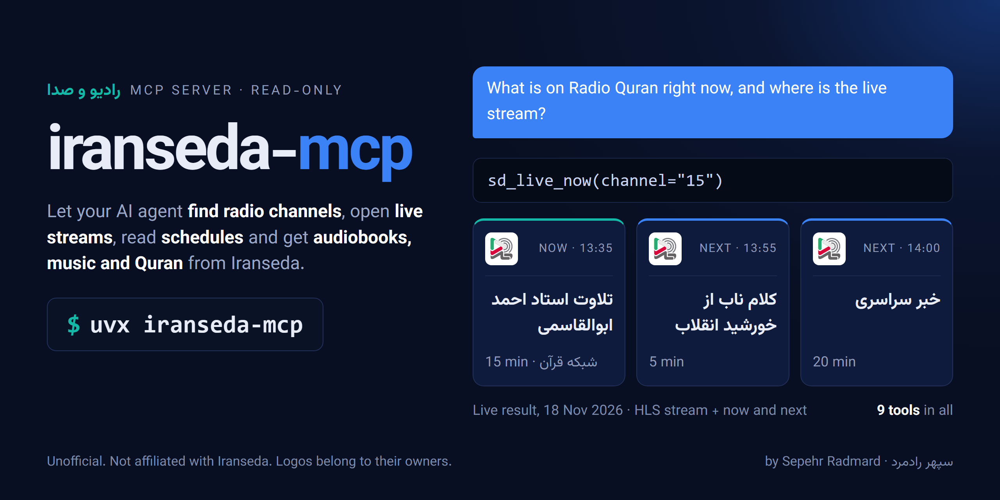

<!-- mcp-name: io.github.sepehr071/iranseda-mcp -->

<div align="center">



# iranseda-mcp: Iranseda (ایران‌صدا) IRIB radio and audio archive MCP server for AI agents

**iranseda-mcp is an unofficial, read-only MCP server that lets an AI agent list IRIB radio channels, open their live streams, read daily schedules and find programs, episodes, audiobooks, music and Quran recitations on Iranseda (ایران‌صدا, iranseda.ir), the audio archive of Iran's national broadcaster.**<br>
Its 9 tools list national, provincial and Nama radio channels with what is on now, give a channel's public live stream (HLS) with now and next, show a channel's schedule for a day, find a radio program by name, show its episodes and an episode's audio files, and search the audiobook, music, kids, speech, nava and Quran libraries down to mp3 and mp4 links.<br>
No API key or account is needed; it works in Claude, Cursor, Copilot and any other MCP client.

[](https://pypi.org/project/iranseda-mcp/)
[](https://pypi.org/project/iranseda-mcp/)
[](https://github.com/sepehr071/iranseda-mcp/actions/workflows/ci.yml)
[](https://github.com/sepehr071/iranseda-mcp/blob/main/LICENSE)

[For AI agents](#for-ai-agents) · [Quick start](#quick-start) · [Tools](#tools) · [Limits](#limits) · [فارسی](#فارسی)

</div>

---

## For AI agents

- **What:** unofficial MCP server (model context protocol) for Iranseda: radio channels, live streams, schedules, programs, episodes, and the audiobook, music, kids, speech, nava and Quran libraries.
- **Install:** `uvx iranseda-mcp` or `claude mcp add iranseda -- uvx iranseda-mcp`. Transport: stdio. Needs [uv](https://docs.astral.sh/uv/getting-started/installation/) (Python 3.10+).
- **Auth:** none. Optional `IRANSEDA_MCP_PROXY` (HTTP proxy URL, or a comma-separated list); system proxy settings are ignored.
- **Access:** read-only. It cannot log in, play audio or download files; results give stream and file URLs.
- **Tools:** 9, all prefixed `sd_`. Typical sequences: `sd_channels` -> `sd_live_now` / `sd_schedule`; `sd_search_programs` -> `sd_program` -> `sd_episode`; `sd_library_search` -> `sd_library_item` -> `sd_library_file`.
- **Use when:** the user asks what is on a radio channel now, wants the live stream link of Radio Quran, Radio Iran or another IRIB channel, wants a program's recent episodes and their mp3 files, or wants an audiobook, a recitation or a sermon from Iranseda.
- **Output:** compact JSON. Dates are Gregorian (the site shows Jalali), times are Tehran time, durations are minutes. Titles are Persian.

## Quick start

You need [uv](https://docs.astral.sh/uv/getting-started/installation/). No API key or account.

Claude Code:

```bash
claude mcp add iranseda -- uvx iranseda-mcp
```

Claude Desktop, Cursor, VS Code and other clients:

```json
{
  "mcpServers": {
    "iranseda": { "command": "uvx", "args": ["iranseda-mcp"] }
  }
}
```

Example prompts:

- "What is on Radio Quran right now, and what is its live stream?"
- "Show today's schedule of Radio Iran."
- "Find an audiobook about Islamic thought in the Quran on Iranseda."
- <span dir="rtl">الان در رادیو قرآن چه برنامه‌ای پخش می‌شود؟</span>
- <span dir="rtl">برنامهٔ «به افق آفتاب» را در رادیو ایران پیدا کن و آخرین قسمت‌هایش را بده.</span>

Real answer (18 Nov 2026): `sd_live_now(channel="15")` returned the Radio Quran (شبکه قرآن) HLS stream `https://s1cdn3.iranseda.ir/liveedge/radio-quran/playlist.m3u8`, now "تلاوت استاد احمد ابوالقاسمی" from 13:35 for 15 minutes, then a 5-minute interlude, "كلام ناب از خورشید انقلاب" at 13:55 and the national news at 14:00.

## Tools

| Tool | What it returns |
|---|---|
| `sd_channels` | IRIB radio channels (national, provincial or Nama) with the program playing now and channel ids |
| `sd_live_now` | A channel's public HLS live stream URL, plus the program on now and the next ones |
| `sd_schedule` | A channel's programs for one day: start time, length, title, program and episode ids |
| `sd_search_programs` | Programs of one channel whose name contains a text (the site has no global search) |
| `sd_program` | A program's description, broadcast time and its latest episodes, about 20 per page |
| `sd_episode` | One episode's date, description and the audio file URL of each part |
| `sd_library_search` | Audiobooks, music, kids, speeches, nava and Quran recitations by text or category code |
| `sd_library_item` | One library item's details (narrator, singer, category) and its tracks |
| `sd_library_file` | The mp3 and mp4 download links and sizes of one library track |

## Limits

- The site has no JSON API and no global search. `sd_search_programs` filters one channel's program list by name; library sub-sites have a real search, except the Quran site, whose search is broken upstream (use a category code such as `ga`).
- Results are parsed from the site's HTML, so a redesign can break a tool. The site sometimes answers a blank page; the server retries and then returns an error.
- Live streams were checked for 77 channels on 18 Nov 2026: 63 gave a playlist, 12 timed out on one CDN node and 2 provincial channels (Zabol, Marivan) answered 404. Whether a given player accepts a stream was not tested.
- The program list marks a program that is airing as ended; that field (`ended_jalali`) is exposed but not trusted.
- Audio files are never fetched or played; mp3 and mp4 links are returned as URLs only. The podcast sub-site is an empty stub and is not covered.
- It worked from an Iranian line and through a foreign proxy in testing; if your network is blocked, set `IRANSEDA_MCP_PROXY`. The server ignores system proxy variables on purpose.

## فارسی

<div dir="rtl">

**iranseda-mcp** یک سرور MCP غیررسمی و فقط‌خواندنی برای ایران‌صدا (iranseda.ir)، آرشیو صوتی سازمان صداوسیما است. با آن یک عامل هوش مصنوعی می‌تواند شبکه‌های رادیویی را فهرست کند، پخش زندهٔ هر شبکه و برنامهٔ در حال پخش را بگیرد، جدول پخش یک روز را ببیند، برنامه‌ها و قسمت‌ها را پیدا کند و به فایل صوتی هر قسمت برسد. کتاب‌های گویا، موسیقی، سخنرانی، نوا و تلاوت‌های قرآن هم قابل جست‌وجو هستند. بدون حساب کاربری و کلید API کار می‌کند. نصب در Claude Code:

</div>

```bash
claude mcp add iranseda -- uvx iranseda-mcp
```

## Development

```bash
uv sync
uv run ruff check . && uv run ruff format --check .
uv run python -m pytest -q          # offline tests on recorded fixtures
uv run python -m pytest -m live -q  # live calls to iranseda.ir
```

Releases: bump the version in `pyproject.toml` and `server.json`, run `uv lock`, then push a `v*` tag; GitHub Actions publishes to PyPI.

## Disclaimer

Unofficial and not affiliated with or endorsed by Iranseda or IRIB. It is read-only and uses the public pages of iranseda.ir, which can change without notice.

## Author

Built and maintained by **Sepehr Radmard** (سپهر رادمرد). [LinkedIn](https://www.linkedin.com/in/sepehr-radmard) · [GitHub](https://github.com/sepehr071) · more servers in [iran-mcp](https://github.com/sepehr071/iran-mcp).

## مجوز استفاده (License)

<a href="https://www.linkedin.com/in/sepehr-radmard"></a>

**استفادهٔ شخصی و غیرتجاری رایگان است.** استفاده در شرکت، محصول پولی یا پروژهٔ مشتری به مجوز تجاری نیاز دارد؛ از راه [لینکدین](https://www.linkedin.com/in/sepehr-radmard) یا [گیت&zwnj;هاب](https://github.com/sepehr071) با سپهر رادمرد تماس بگیرید. متن کامل: [PolyForm Noncommercial 1.0.0](https://github.com/sepehr071/iranseda-mcp/blob/main/LICENSE).

Free for personal and non-commercial use under the [PolyForm Noncommercial License 1.0.0](https://github.com/sepehr071/iranseda-mcp/blob/main/LICENSE). Using it in a company, a paid product or a client project needs a commercial license: contact Sepehr Radmard on [LinkedIn](https://www.linkedin.com/in/sepehr-radmard) or [GitHub](https://github.com/sepehr071).
